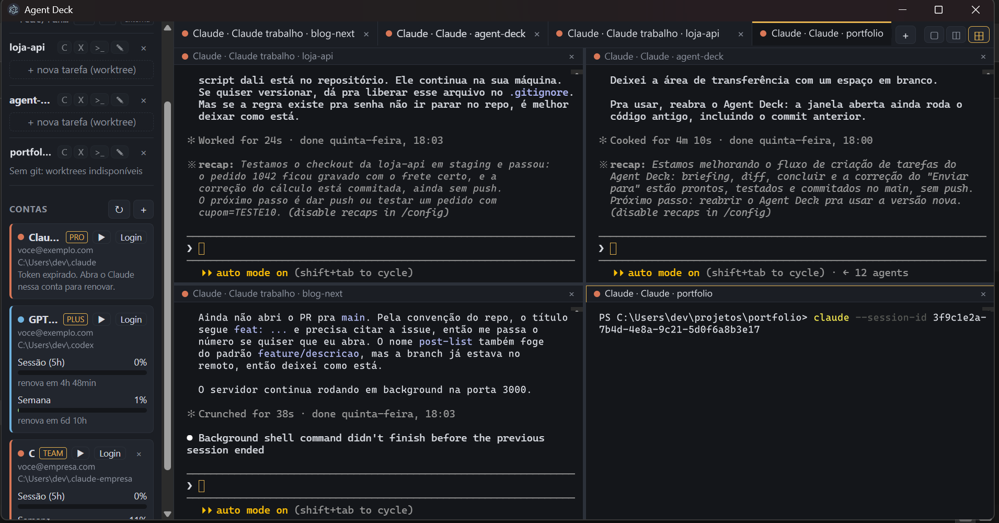

# Agent Deck

*[Read in English](README.md)*



Terminal multi-agente pessoal para Windows: abas de Claude Code e Codex, várias contas de cada,
worktree git por tarefa, painel de uso por conta, editor (Monaco) e navegador embutidos.

## Rodar

```bash
npm install
npm start
```

Teste de fumaça (abre as abas, tira screenshots, grava o console e fecha):

```bash
AGENT_DECK_SMOKE=/caminho/saida npm start
```

## Como funciona

| Parte | Onde | O que faz |
| --- | --- | --- |
| Janela, IPC, protocolo `app://` | `src/main/main.js` | Único lugar com acesso a disco, rede e processos |
| Terminais | `src/main/pty.js` | Decide shell, ambiente da conta e comando; o agente é digitado no shell, à vista |
| ConPTY | `src/main/pty-host.js` | Processo filho (Node) que roda o `node-pty`: no main do Electron o ConPTY travava |
| Status e sessões | `src/main/agents.js` | Lê `<conta>/sessions/<pid>.json` (Claude) e os rollouts do Codex: status e id da conversa |
| Contas | `src/main/store.js` | Cada conta = um diretório (`~/.claude-<nome>`, `~/.codex-<nome>`) |
| Uso/limites | `src/main/usage.js` | Lê o token salvo pela CLI e consulta o endpoint de uso |
| Worktrees | `src/main/git.js` | `git worktree add -b task/<nome>` em `<repo>.worktrees/<nome>` |
| Arquivos do editor | `src/main/files.js` | Leitura/escrita restritas às pastas de projeto |
| UI | `src/renderer/` | Sandbox, sem Node, só fala com o main pela ponte do `preload` |

### Contas

- **Claude**: abas com conta não-padrão recebem `CLAUDE_CONFIG_DIR=<dir da conta>`. A conta padrão
  usa `~/.claude` + `~/.claude.json`, como a CLI faz sem a variável.
- **GPT**: idem com `CODEX_HOME`. Precisa do Codex CLI instalado (`npm i -g @openai/codex`).
- Na primeira execução o app já importa `~/.claude`, `~/.codex` e qualquer `~/.claude-*` / `~/.codex-*` existente.
- "Login" abre um terminal com a conta: Claude pede login sozinho (ou `/login`), Codex roda `codex login`.
- Nada de trocar arquivo de credencial de lugar: cada conta tem o seu diretório, sempre.

### Tarefas (worktree do começo ao fim)

- **Criar**: "+ nova tarefa" pede nome, **base** (de onde sai e para onde volta) e um **briefing** opcional.
  No Claude, o briefing é enviado como primeira mensagem assim que ele chega no prompt, depois do diálogo
  "trust this folder" (o sinal é o arquivo de sessão, que só nasce após o diálogo). No Codex, que não
  publica status, ele vai para a área de transferência.
- Base e briefing ficam no próprio git: `branch.<b>.deckbase` e `branch.<b>.description`.
- **Sidebar**: `↑N` = commits à frente da base, `●N` = arquivos sem commit. Botões no hover.
- **± Diff**: tudo que a tarefa mudou desde a base, commitado ou não, no diff do Monaco.
- **Linhas ao vivo**: o card mostra `+N −M · K arq` (desde a base, com o que não foi commitado e arquivos novos; nos cards
  "(raiz)", o que está sem commit na pasta do projeto). Relido a cada 6 s enquanto um agente da tarefa trabalha;
  o número acende quando muda.
- **Worktree que nasce pronta** (⚙ no projeto): arquivos para copiar em cada worktree nova (o que o git ignora,
  ex.: `.env`, `appsettings.Development.json`) e um comando digitado no terminal da tarefa antes do agente
  (`npm ci`, `dotnet restore`…). Na primeira vez vem com sugestão (ignorados na raiz do projeto, comando pelo
  lockfile/`.sln`/`.csproj`). Daí em diante, a nova tarefa oferece "Preparar a worktree".
- **✓ Concluir** (ou arrastar o card para "Concluídas"): uma caixa só — em qual branch integrar, para onde enviar
  (nenhum remoto, um, ou todos) e merge ou squash; ou pull request em um/todos os remotos (envia a branch da tarefa e
  abre a página de "novo PR" do GitHub / Azure DevOps; não precisa do `gh`). Antes, commita o que sobrou. Se a base não
  está aberta em nenhuma pasta, integra numa worktree temporária. Vale também para worktrees criadas fora do app
  (ex.: `.claude/worktrees` do Claude Code). Se der conflito, nada é tocado e ele oferece mandar o agente da tarefa
  juntar a base e resolver. No fim, fecha as abas, remove a worktree e apaga a branch se ela já estiver toda na base.
- **Arrastar cards**: A fazer → qualquer coluna ativa começa a tarefa; uma tarefa → "Pra revisar" abre o diff,
  → "Trabalhando"/"Esperando você" abre ou foca o agente, → "Concluídas" conclui (ou encerra uma "(raiz)").

Teste do ciclo (cria repo descartável, abre Claude de verdade com briefing, diff, concluir):
`AGENT_DECK_SMOKE=<pasta curta> AGENT_DECK_SMOKE_TASK=1 npm start`. Use pasta curta: o git no Windows
falha em caminho muito longo. O teste marca a pasta temporária como confiável no `~/.claude.json`.

### Quadro (tela inicial)

O quadro é a primeira aba, sempre aberta (Ctrl+Shift+Q traz pra frente). As colunas não são arrastadas:
saem do estado real dos agentes e do git, então o quadro não tem como ficar desatualizado.

| Coluna | O que tem |
| --- | --- |
| A fazer | Tarefas na fila: nome, projeto e briefing, ainda sem worktree. "▶ Começar" abre o form de nova tarefa preenchido |
| Esperando você | Algum agente da tarefa pediu permissão ou resposta |
| Trabalhando | Algum agente está ocupado |
| Pra revisar | Agentes parados e a tarefa tem commits ou mudanças sem commit |
| Parada | Sem agente, ou parada sem mudança |
| Concluídas | Merges, squashes e PRs, registrados pelo processo principal quando dão certo (com link do PR) |

Cada card mostra o briefing, cada agente com estado e há quanto tempo ("trabalhando · há 4 min") e a
**última fala** do agente, lida do fim da conversa em disco: texto, ou a ferramenta que ele está pedindo
enquanto espera ("Pediu: Write: src/a.js"). Agentes rodando na própria pasta do projeto aparecem como a
tarefa "(raiz)" dele. No Codex, estado e última fala vêm do arquivo de rollout (`task_started` /
`task_complete`); ele não tem "esperando você", um turno interrompido com Esc (`turn_aborted`) vira "parado" na hora, e um turno sem nada escrito há 5 minutos também.

### No dia a dia

- **Painéis**: 1, 2 lado a lado ou 4 (2×2) — botões no canto da barra de abas ou Ctrl+Shift+1/2/4.
  Clicar numa aba fora da tela coloca ela no painel focado (borda amarela).
- **Sidebar**: arraste a borda para mudar a largura; Ctrl+Shift+B esconde.
- **Projetos**: sem cadastrar nem remover. Em "+ → Pasta-raiz", cada subpasta vira projeto, inclusive as criadas
  depois (menos `_nome`, `.nome` e `*.worktrees`); "Uma pasta só" adiciona uma avulsa. A barra mostra "Em uso"
  (aba aberta, tarefa, card na fila, conversa dos últimos 3 dias ou fixado com ☆) e recolhe o resto em "Outros",
  com filtro no topo. Na primeira abertura, a pasta que já tem dois ou mais projetos cadastrados vira raiz.
- **Pasta no Explorer**: Ctrl+Shift+E (ou 📂 na barra de abas) abre a pasta da tarefa da aba atual — a worktree, ou a
  pasta do projeto; no quadro, a do agente que mais pede atenção. Também 📂 em cada card, no cabeçalho do painel e na paleta.
- **Paleta de comandos**: Ctrl+Shift+P de qualquer lugar, ou Ctrl+K fora do terminal e do editor (no prompt do
  agente o Ctrl+K apaga até o fim da linha). Busca aproximada em abas, tarefas (e diff/concluir), fila "A fazer",
  ações por projeto e layout.
- **Cor por conta**: cada conta tem uma cor (automática, ou escolha no card da conta). Aparece na faixa e na
  etiqueta dos cards do quadro, no sublinhado da aba e no cabeçalho do painel: dá pra ver em que conta cada agente está.
- **Status**: a bolinha da aba pulsa enquanto o Claude trabalha; quando ele termina numa aba que você
  não está olhando, ela fica destacada ("terminou") até receber foco. Quando o Claude pede permissão a aba
  fica vermelha ("esperando você": o arquivo de sessão diz `status: "waiting"`). Com o app em segundo plano,
  os dois casos geram notificação do Windows e piscam a barra de tarefas; clicar na notificação abre a aba.
  O Codex também mostra trabalhando/terminou (lido do rollout), mas nunca "esperando você".
- **Reabrir**: ao abrir, o app recria as abas da última vez. Claude volta com `claude --resume <id>`
  (cada aba na sua conversa; o app abre cada uma com `--session-id` próprio). Sem nenhuma mensagem
  enviada, não há conversa em disco e abre uma nova. Codex volta com `codex resume <id>` quando o id
  foi descoberto. O que estava rodando no momento de fechar é interrompido. No quadro, "Conversas fechadas"
  lista as dos últimos dias; o × tira uma da lista de vez (ela continua no histórico do Claude).
- **Bolinha da aba** = estado do agente: vazada parado, amarela pulsando trabalhando, vermelha pulsando esperando
  você, verde terminou. Outras abas mostram um ícone (`>_` terminal, ✎ editor, ± diff, ▦ quadro); a do Codex tem a etiqueta "GPT".
- **Contexto**: quanto da janela a conversa ocupa, da última resposta em disco (Claude: `usage` da conversa, janela de
  1M com modelo `[1m]` na conta ou acima de 200k; Codex: `token_count` do rollout). Barrinha em cada agente do card,
  no cabeçalho do painel e, de 70% pra cima, etiqueta na aba (amarela; vermelha a partir de 90%). Ao passar de 90%,
  notificação do Windows com o app em segundo plano.
- **Entre agentes**: botão direito num terminal → "Enviar seleção/área de transferência para" outra aba de
  agente. Cola no prompt (bracketed paste), sem Enter. No Claude, selecione com Shift+arrastar.
  Abas de Claude da **mesma conta** também conversam nativamente (`ListAgents`/`SendMessage` do Claude Code).

## Segurança: o que este app faz e não faz

- **Sem auto-update, sem telemetria, sem download em tempo de execução.** O app só sai para a rede
  em dois endpoints de uso (abaixo) e no que você abrir no navegador embutido.
- **Tokens não saem do processo principal.** A UI recebe só porcentagens e horários.
  Tokens nunca são renovados pelo app (renovar rotaciona o refresh token e desloga a CLI).
- **Endpoints de uso são internos e não documentados — não é API oficial:**
  `api.anthropic.com/api/oauth/usage` e `chatgpt.com/backend-api/wham/usage`. Podem mudar ou sumir;
  se quebrar, só o painel de uso para de funcionar. Consulta no máximo a cada 5 min por conta.
- **Renderer em sandbox** (`contextIsolation`, `sandbox`, sem `nodeIntegration`), CSP restrita,
  janela principal não navega para fora de `app://`, e `app://` só serve `src/renderer` e três pastas de `node_modules`.
- **Navegador embutido** (`<webview>`) sem preload e sem Node, popups abrem na própria aba.
- **Editor/arquivos** só dentro das pastas de projeto cadastradas (e das worktrees delas).
- **O renderer não manda comando livre para o shell**: só escolhe entre `claude`, `codex` e `codex login`,
  mais um id de sessão para reabrir, que o main valida como UUID antes de pôr no comando, e um "preparar": o
  comando de preparo de worktree é o que *você* salvou no projeto, lido pelo main do `state.json` (uma linha,
  digitada à vista antes do agente). Os arquivos a copiar também vêm de lá, só relativos ao projeto.
  Depois disso é um terminal normal, então o que o agente executa é responsabilidade das permissões do próprio agente.
- **Envio entre abas** só cola em abas de agente (num terminal puro viraria comando). No Claude, só depois que o
  arquivo de sessão diz que ele está no prompt (ele não existe durante o diálogo "trust this folder", onde o texto
  colado poderia responder por você). O bracketed paste sozinho não prova isso: o pwsh já liga o modo.
- **Remover worktree** usa `git worktree remove` sem `--force`: com mudança não commitada, o git recusa.

## Dependências (versões fixas)

`electron`, `node-pty`, `@xterm/xterm`, `@xterm/addon-fit`, `monaco-editor`. Nada de bundler.
O `npm audit` acusa 2 avisos *low* no DOMPurify dentro do Monaco; irrelevante para um editor que só abre seus arquivos.

## Antivírus

O `.exe` do Electron é assinado pela própria Electron, mas o app em si não é empacotado nem assinado.
Rodando via `npm start`, quem executa é o `electron.exe` oficial. Se algum dia empacotar, assine
(ou o Bitdefender vai reagir igual reagiu ao Ghostex: exe sem assinatura que abre shells).

## Licença

[MIT](LICENSE)
